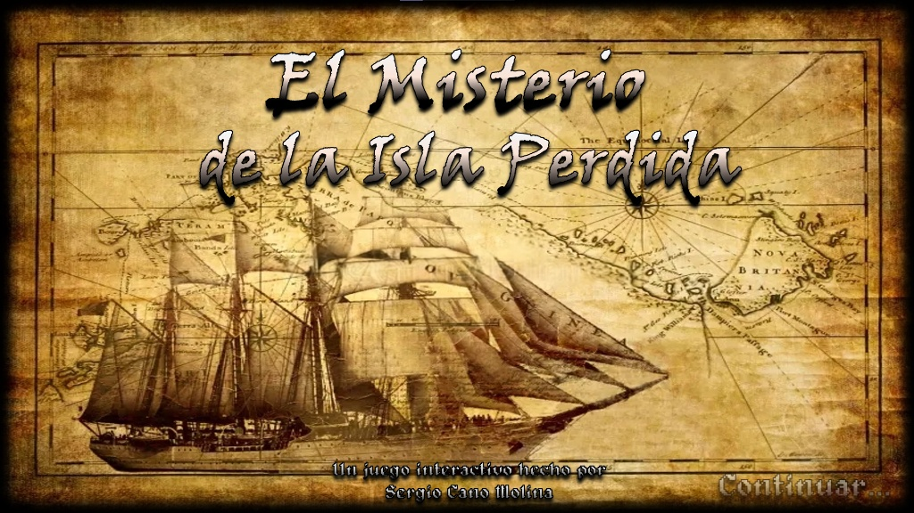
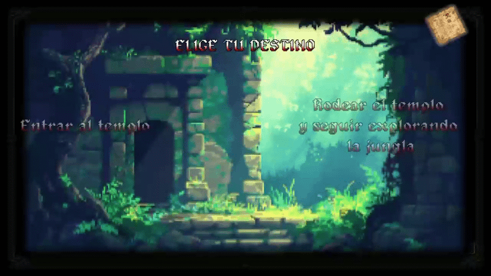
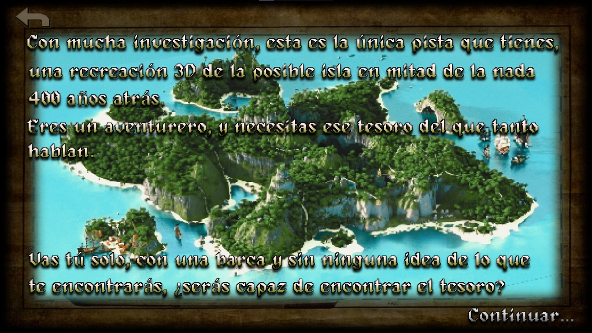
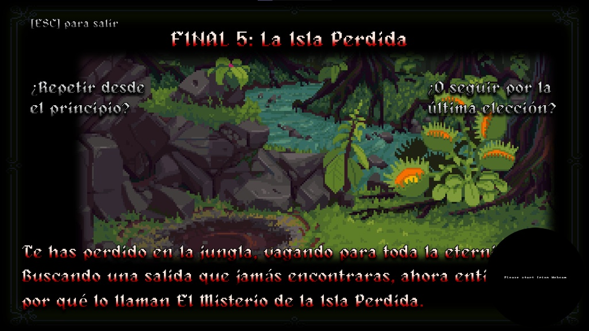
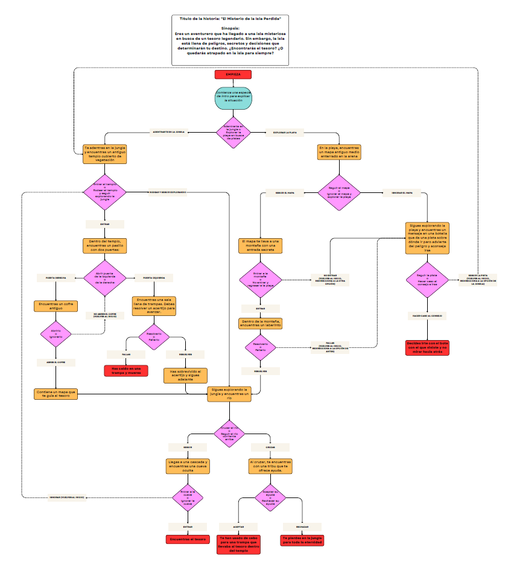

# El Misterio de la Isla Perdida

> **[Hablan de un barco deambulando por el océano sin fin... Hablan de una batalla bajo la tormenta... Pero antes de eso, hablan de una llegada a una isla... Y hablan de una salida...
Y hablan de un mapa... Y hablan de un posible tesoro...]**

---

## 📖 Descripción

Un trabajo final que hice para 1º SMR antes de irme de prácticas, la tarea era hacer un PowerPoint interactivo y elegí hacer un videojuego con dibujos, sonidos y música ya existente.

---

## Gameplay

---

## Capturas de pantalla

| Introducción | Finales alternativos |
| :---: | :---: |
|  |  |

---

## Diagrama de decisiones y rutas

<b>Haz clic para desplegar el mapa completo de decisiones (⚠️ Contiene Spoilers)</b>

 

> **[El juego tenía que tener un storyboard con todas las decisiones y aquí se puede ver con detalle todas las posibilidades.]**
---

## Cómo jugar

1. Descarga el archivo `.pptx` (o `.ppsx`) desde este repositorio.
2. Ábrelo en **Microsoft PowerPoint**.
3. Inicia la presentación en pantalla completa (`F5`) y haz clic sobre las opciones en pantalla para avanzar.
